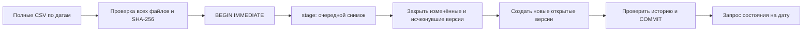

# Конспект: история справочника SCD Type 2 на SQLite

16 октября 2026 года, версия 0.1.0. Новый основной инструмент — SQLite и SQL.
[Инструкция запуска](README.md) · [Все технологии](TECHNOLOGIES.md).
Это учебный проект на вымышленных товарах, без заявления о коммерческом опыте.

## 1. Задача простыми словами

Пусть магазин получает полный справочник товаров несколько раз в месяц.
Сегодня чай стоит 250 рублей, через четыре дня — 275. Если просто заменить цену
в таблице, исчезнет возможность объяснить старое состояние справочника. Ещё сложнее,
когда товар временно исчезает, а потом возвращается. Нужна история, которую можно
прочитать на конкретный день, сохранив старые значения.

Вход проекта — три CSV с полными снимками. Выход — локальная база SQLite с версиями
товаров. Команда `as-of` показывает, что считалось действующим на выбранную дату.
Результат полезен для понимания измерений хранилища и соединения фактов с историей.
Продаж и расчёта выручки здесь нет: историческая цена справочника сама по себе
не доказывает фактическую цену сделки или размер скидки.

## 2. Что изучаем

SCD Type 2 означает сохранение изменившихся атрибутов отдельными версиями строки.
Естественный ключ `product_id` обозначает товар, а `product_version_id` — конкретную
версию его состояния. Один товар может иметь несколько ключей версии. Такой ключ
удобен, когда факт должен ссылаться на состояние измерения в определённый момент.

В отличие от предыдущего проекта на Polars, здесь результат накапливается в базе.
Удаление старого CSV не удаляет уже принятую историю. Изучаем интервалы действия,
частичный уникальный индекс, промежуточную таблицу, контрольные точки и транзакцию.
SQLite выбран потому, что позволяет увидеть SQL и состояние на диске без установки
сервера. Простой альтернативой была бы история в CSV, но ограничения уникальности
и согласованное изменение нескольких таблиц пришлось бы реализовывать самостоятельно.

Здесь ровно одна временная ось: день начала действия снимка. Время получения файла
не моделируется. Поэтому это не двухвременное хранилище, которое умеет ответить,
что было действительно и что мы об этом знали в конкретный момент загрузки.

## 3. Данные и контракт

Единица входа — товар в полном снимке. Имя файла `catalog-2026-10-05.csv` задаёт дату.
Каждая строка имеет код, название, категорию и целую цену в копейках. Валюта демо —
рубль. Цена 25000 означает 250,00 ₽; хранение целого числа исключает двоичное
округление суммы, которое возникло бы при использовании float.

Код имеет вид P- и четырёх ASCII-цифр. Дубликат кода в одном снимке считается ошибкой,
даже если строки одинаковы: источник должен однозначно описывать состояние товара.
Названия и категории ограничены 80 символами. Цена находится в пределах
от нуля до 100 миллионов копеек. Строки с дробью, знаком или ведущими нулями отклоняются.

Генератор использует только константы. Первый файл содержит четыре товара, второй —
три, третий — пять. Случайности нет, поэтому повторная генерация в другую пустую
папку даёт те же байты. Имена файлов и состав снимков доступны для чтения в
`catalog_history/synthetic.py`; сторонних источников и личных данных нет.

Ключевая договорённость: отсутствие товара означает его исчезновение. Поэтому
выгрузка должна быть полной. Пустой файл с правильным заголовком закрывает все товары.
Для промышленного источника дополнительно понадобились бы признаки завершённости
поставки и сверка контрольных количеств. Наш загрузчик не может сам доказать,
что отправитель случайно не обрезал корректный CSV.

## 4. Архитектура



`pipeline.py` проверяет вход и управляет состоянием, `sql/schema.sql` задаёт таблицы,
`apply_snapshot.sql` меняет интервалы, `as_of.sql` читает историю. В памяти находятся
проверенные строки всех входных снимков; в SQLite — постоянная история и временная
таблица `stage` для одного снимка. Это простая пакетная схема для небольших наборов,
а не потоковая обработка неограниченного размера.

Таблица `batches` хранит дату и SHA-256 прочитанных байтов. Внешние ключи связывают
границы версий с принятыми снимками; их проверка явно включается через PRAGMA.
STRICT-таблицы и CHECK ограничивают типы и допустимый диапазон цены. Частичный индекс
с `WHERE valid_to IS NULL` допускает лишь одну открытую версию данного товара.
Отдельная проверка ищет пересечения закрытых интервалов: одного индекса для этого мало.

## 5. Проводим строки через обработку

1 октября чай открывается с ценой 25000 и интервалом `[2026-10-01, NULL)`.
5 октября цена стала 27500. Старая строка получает `valid_to = 2026-10-05`, новая —
`valid_from = 2026-10-05`. Именно 5 октября возвращается новая цена. Старую цену
можно получить 4 октября; две версии на границе одновременно не действуют.

Блокнот сначала существует, 5 октября отсутствует и 10 октября возвращается.
Его первая версия закрывается 5 октября, следующая открывается 10 октября.
В промежутке нет действующей строки. Возвращение создаёт новую версию даже тогда,
когда атрибуты совпали бы со старыми. Непрерывность старой версии была бы неправдой.
Кружка 5 октября не меняется: её ключ версии сохраняется. 10 октября меняется
категория — появляется следующая версия кружки.

Обновление выполняется двумя SQL-командами. Сначала закрываются открытые строки,
для которых в `stage` нет полностью совпадающего состояния. Затем открываются
товары, для которых после закрытия не осталось текущей версии. Это включает
новые товары, изменения и возвращения. Атрибуты сравниваются напрямую;
хэш используется для идентичности файла, а не вместо сравнения значений товара.

Запрос состояния содержит условие:

```sql
WHERE valid_from <= :as_of
  AND (valid_to IS NULL OR :as_of < valid_to)
```

Это полуоткрытый интервал: начало включено, конец исключён. Параметр передаётся
отдельно от SQL, строковая конкатенация значения даты не используется.
Даты валидируются и хранятся в одинаковом формате YYYY-MM-DD, поэтому их текстовый
порядок подходит для нашей дневной модели. Будущее после последнего снимка запрещено:
открытый интервал не означает, что источник подтвердил состояние на любой будущий день.

## 6. Повторы, ошибки и восстановление

Если дата уже принята и хэш совпадает, файл пропускается. Даже изменение переводов
строк меняет хэш: это строгая идентичность байтов, а не смысловая идентичность CSV.
Если новая дата позже последней и атрибуты не изменились, контрольная точка добавляется,
но новых версий нет. Значит, мы подтвердили состояние ещё на одну дату без дублирования.

Новый файл с датой из прошлого отклоняется. Поддержать его нельзя простым закрытием
текущих строк: пришлось бы пересчитать соседние интервалы и ссылки фактов.
Изменение уже принятого снимка также запрещено. Отдельная пересборка истории —
возможное расширение, которое должно иметь собственные правила и проверки.

Все входы проверяются до изменений. Неверная строка останавливает запуск целиком.
Если бы мы отправили её в карантин и продолжили, товар исчез бы из `stage`,
а загрузчик ошибочно закрыл бы его текущую версию. Политика ошибок зависит
от смысла источника: правила для событий не переносятся на полный снимок автоматически.

Для новых снимков открывается одна явная транзакция. В ней находятся и версии,
и контрольные точки. При исключении выполняется ROLLBACK. Тест искусственно
вызывает сбой после изменения второго нового снимка и проверяет, что оба изменения
отменены, а старое состояние сохранилось. Создание пустой схемы — отдельный этап:
после неудачной первой загрузки она может остаться, но повтор её использует.

Важно не применять `executescript` к обновлениям внутри этой транзакции:
у интерфейса Python есть поведение неявного завершения ожидающей транзакции.
В реализации две известные SQL-команды выполняются отдельно через `execute`.
Первичное создание схемы само задаёт собственные BEGIN и COMMIT.

## 7. Проверяем понимание

Выполните команды README: `demo`, `load`, три запроса `as-of`, повторный `load`
и `python scripts/smoke_check.py`. Получатся 9 версий и 5 актуальных товаров.
Из 9 версий 4 закрыты. На 5 октября видны 3 товара, на 10 октября — 5.
Проверяйте конкретные значения, а не только отсутствие исключения.

`python -m unittest discover -s tests -v` проверяет границы дат, пропуски, возвраты,
неизменные атрибуты, повтор, контракты и откат. Тесты SQL-ограничений пытаются создать
вторую открытую строку и нулевой интервал. Проверка публикации ищет секреты и контакты,
небезопасные пути и файлы вне явного перечня. Это отдельная задача от правильности SCD2.

## 8. Что обнаружилось при разработке

Первый набор из 19 функциональных тестов прошёл без падений; историю ошибки алгоритма
здесь не придумываем. При подготовке окружения обычный `venv` не создал окружение
из-за отсутствующего ensurepip в установленной сборке Python. Решение —
`venv --without-pip`: внешние пакеты проекту не нужны. Глобально ничего не устанавливалось.

Из предыдущего проекта учтена зависимость Windows от кодировки консоли: файлы
читаются явно как UTF-8, команды настраивают такой же вывод. Отдельный тест запускает
команду при принудительной cp1252. Это профилактика известного класса ошибок,
а не утверждение о новом падении на Windows; фактический результат CI записан в VALIDATION.md.

На первом запуске CI Windows обнаружилась новая ошибка в тестовых помощниках:
`with sqlite3.connect(...)` завершает транзакцию, но не закрывает соединение.
Открытый файл мешал удалить временную папку: появлялся WinError 32. Исправление —
`contextlib.closing` снаружи контекста транзакции. Основной загрузчик и запрос уже
использовали явное закрытие; исправлены тесты и пример просмотра базы в README.
Так различаются жизненный цикл соединения и граница транзакции. Linux допускал
удаление открытого файла, поэтому локальные проверки эту ошибку не выявили.

## 9. Ограничения и следующий шаг

Дневная точность теряет несколько изменений внутри дня. Нет поздних исправлений,
нескольких валют, миграций схемы и двухвременной истории. Для загрузки предполагается
один запускающий; SQLite ждёт блокировку до пяти секунд и может отказать.
Нагрузочный тест, сбой питания и изменение входных файлов другим процессом не проверены.

Все снимки читаются в память в пределах явных лимитов. Имя и метка приложения
помогают избежать случайного изменения чужой базы, но это не механизм разграничения
доступа или защита от злонамеренного изменения файла. Следующий разумный шаг —
маленькая таблица фактов с поиском правильного ключа версии по дате продажи.

## 10. Собеседование и упражнения

Проект можно описать честно: «На синтетических полных снимках реализовал историю
товаров в SQLite, проверил полуоткрытые интервалы и откат нескольких новых поставок».

Пять вопросов с короткими ответами:

- Почему отдельный ключ версии? Код товара один, состояний за время может быть несколько.
- Почему конец интервала исключён? На границе действует одна версия, запрос не удваивает товар.
- Почему недостаточно UNIQUE(product_id)? Он запретит хранить историю одного товара.
- Почему контрольная точка внутри транзакции? Иначе файл может считаться принятым без всех его версий.
- Почему нельзя молча отбросить плохую строку? Полный снимок трактует отсутствие как исчезновение.

Упражнения выполняйте в отдельной синтетической папке:

1. Добавьте 12 октября неизменный полный снимок последнего состояния. Ожидаются
   4 принятые даты, те же 9 версий и 5 актуальных товаров.
2. В этом новом снимке измените только цену чая. Ожидаются 10 версий, 5 актуальных
   товаров и новая цена ровно с 12 октября. Не редактируйте уже загруженный файл:
   создайте отдельную базу или сразу используйте окончательный снимок.
3. Добавьте 13 октября снимок с одним заголовком. После предыдущего упражнения
   останутся 10 исторических версий и 0 актуальных товаров. Запрос 12 октября
   по-прежнему должен вернуть 5 товаров.
4. В копии снимка повторите код P-0001. Загрузка должна завершиться ошибкой,
   а строки обеих постоянных таблиц до и после должны совпасть.
5. Добавьте запрос количества версий по товару. Для исходного демо ожидаются
   2, 2, 2, 2 и 1 версия для кодов P-0001…P-0005 соответственно.

## 11. Официальные источники

- [Python sqlite3](https://docs.python.org/3.12/library/sqlite3.html): параметры запросов,
  режим URI и управление транзакциями; сверяйте поведение с выбранной версией Python.
- [Транзакции SQLite](https://www.sqlite.org/lang_transaction.html): BEGIN IMMEDIATE,
  COMMIT, ROLLBACK и занятость базы.
- [Частичные индексы](https://www.sqlite.org/partialindex.html): индекс с предикатом,
  на котором основано ограничение одной открытой версии.
- [STRICT-таблицы](https://www.sqlite.org/stricttables.html): поддержка с SQLite 3.37.
- [Внешние ключи](https://www.sqlite.org/foreignkeys.html): включение проверки ссылок.
- [CSV в Python](https://docs.python.org/3.12/library/csv.html): разбор и запись CSV.

Выбор полного снимка, запрет исправлений прошлого и границы нагрузки — решения
этого учебного проекта. Они не являются универсальными требованиями SQLite или SCD2.
